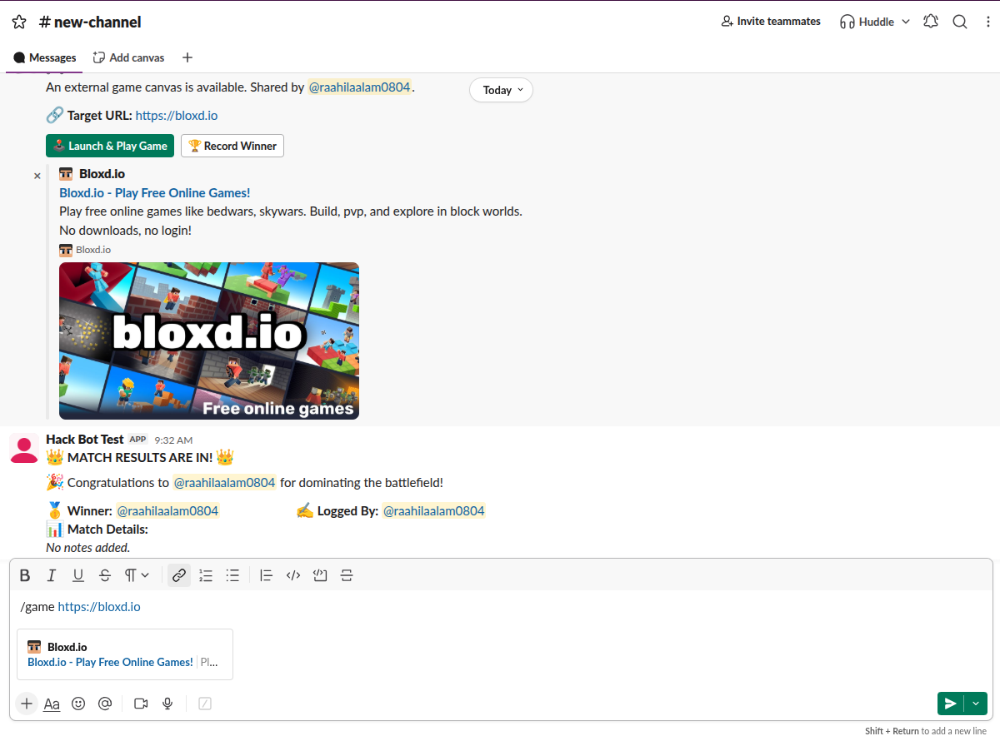

# Game Bot
The most productive fun game hosting bot loaded with jokes, availible on Slack!

### Try it!
You can try the bot out by downloading the .zip from https://github.com/MasterCoder360/SlackBot/releases/tag/Tryit. You need to host it locally(or even cloud) run 
```
npm init -y 
```
npm install @slack/bolt

to install dependencies and packages and then unzip the file. Create a .env file with 
```
export SLACK_APP_TOKEN= 
export SLACK_SIGNING_SECRET=
export SLACK_BOT_TOKEN=


```
And then in slack /invite @GameBot (or your bot name)

### Roadblocks I encountered
I encoutered a few roadblcoks. Like my codespaces limit for github maxed out. But I was able to use Hack Club Spaces for teenagers to complete this project. There was also a hidden bug that I later found out was I didn't add a bracket ender to my code. And the problem I am currectly facing is moving this project from local to cloud but my nest hack club apllication is this not approved yet.
